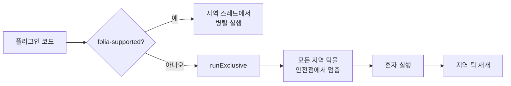

<div align="center">

<a href="https://lumina.aruru.kr"></a>

<br>

[](https://github.com/aruru10313/Lumina/releases/latest)
[](https://github.com/aruru10313/Lumina/releases)
[](https://github.com/aruru10313/Lumina/actions/workflows/release.yml)
[](PATCHES-LICENSE)
[](https://lumina.aruru.kr)

### **[⬇ 다운로드 / Download](https://lumina.aruru.kr/#download)** &nbsp;·&nbsp; [웹사이트 / Website](https://lumina.aruru.kr) &nbsp;·&nbsp; [동작 방식](LUMINA.md) &nbsp;·&nbsp; [문제 신고 / Issues](https://github.com/aruru10313/Lumina/issues)

</div>

> [!WARNING]
> **비공식 프로젝트입니다. PaperMC에서 지원하지 않습니다.**
> Lumina는 PaperMC(Paper·Folia 팀)와 관련이 없습니다. Lumina에서 생긴 문제를 Paper/Folia에 신고하지 말고 [이 저장소](https://github.com/aruru10313/Lumina/issues)에 알려 주세요.
> <br>*Unofficial — not affiliated with or supported by PaperMC. Report issues here, not upstream.*

<br>

## Lumina란?

**Folia 위에서 일반 플러그인도 그대로.**
Lumina는 [Folia](https://github.com/PaperMC/Folia)를 기반으로 한 마인크래프트 서버입니다. 지역마다 병렬로 틱을 돌리는 Folia 구조는 그대로 두고, `folia-supported` 표시가 없는 Paper 플러그인도 로딩해서 안전하게 실행합니다.

<table>
<tr>
<td width="33%" valign="top">

#### ⚡ 지역별 병렬 틱 유지
Folia를 지원하는 플러그인과 월드는 원래처럼 지역마다 다른 스레드에서 돕니다. 성능 손해가 없습니다.

</td>
<td width="33%" valign="top">

#### 🧩 일반 플러그인 호환
`BukkitScheduler`, 동기 `teleport`, 스코어보드 API, 꺼져 있던 바닐라 명령어를 다시 쓸 수 있습니다.

</td>
<td width="33%" valign="top">

#### 🔌 옵션 하나로 순정 Folia
`-Dfolia.legacyCompat=false`를 주면 호환 모드가 꺼지고 Folia와 똑같이 동작합니다.

</td>
</tr>
</table>

<details>
<summary><b>English</b></summary>
<br>

**Folia, with your regular plugins intact.** Lumina is a Minecraft server built on Folia. It keeps Folia's parallel, per-region ticking and also loads Paper plugins that lack `folia-supported`. Their synchronous code runs alone while every region is briefly paused (stop-the-world).

- **Parallel region ticking:** Folia-ready plugins run exactly as on Folia, at no extra cost.
- **Regular plugins work:** `BukkitScheduler`, sync `teleport`, the scoreboard API and previously disabled vanilla commands are back.
- **One flag for stock Folia:** `-Dfolia.legacyCompat=false`.

</details>

<br>

## 지원 버전

| Minecraft | 상태 | Java |
|:--|:--|:--|
| **26.3** | ✅ [다운로드](https://lumina.aruru.kr/#v26.3) | 25+ |
| 26.2 · 26.1 | 🛠 포팅 중 | 25+ |
| 1.21.11 · 1.21.8 · 1.21.7 · 1.21.6 · 1.21.5 · 1.21.4 | ⏳ 예정 | 21+ |
| 1.20.6 · 1.20.4 | ⏳ 예정 | 21+ / 17+ |

> Folia 원본이 있는 버전만 만들 수 있습니다. 최신 상태는 [웹사이트](https://lumina.aruru.kr/#download)에서 확인하세요.

<br>

## 빠른 시작

```bash
java -Xms4G -Xmx4G -jar lumina-1.21.5-b<빌드>.jar --nogui
```

처음 실행할 때 Mojang 서버 파일을 자동으로 받습니다. `eula.txt`에 동의한 뒤 다시 실행하세요.

| JVM 옵션 | 기본값 | 설명 |
|:--|:--:|:--|
| `-Dfolia.legacyCompat=false` | `true` | 호환 모드 전체를 끕니다 (순정 Folia) |
| `-Dfolia.legacyCommands=false` | `true` | 다시 켠 명령어와 명령어 전역 실행만 끕니다 |
| `-Dfolia.legacyCompat.slowWarnMs=100` | `100` | 전역 실행이 이 시간(ms)보다 길면 경고합니다 |

<br>

## 동작 방식



| 상황 | 처리 |
|:--|:--|
| 일반 플러그인이 듣는 동기 이벤트 | 이벤트 전체를 `runExclusive`로 실행 |
| `BukkitScheduler` 동기 작업 | 실행할 작업이 있는 전역 틱에만 `runExclusive` |
| 비동기 작업 | 기존 Paper 방식 그대로 |
| 모든 명령어, 일반 플러그인의 `onEnable` / `onDisable` | `runExclusive` 안에서 실행 |
| 다른 지역의 블록 수정 / 엔티티 / teleport | 스레드의 현재 지역을 잠깐 바꿔서 실행 (`inRegionAt`) |

자세한 내용: **[LUMINA.md](LUMINA.md)**

<br>

## 테스트 결과 (26.3)

- **테스트 플러그인 `compat-test/`:** 11/11 PASS
- **실제 플러그인 18개 동시 실행:** 전부 에러 없이 켜짐 (시작 18초)
  - 호환 모드: Multiverse-Core, AdvancedPortals, NoLeavesDecay, URLCustomDiscs 외 비공개 플러그인
  - Folia 지원: LuckPerms, WorldEdit, WorldGuard, PlaceholderAPI, packetevents, Oraxen, BetterModel

> [!CAUTION]
> 일반 플러그인이 많이 일할수록 서버가 단일 스레드처럼 느려집니다. NMS를 직접 건드리는 플러그인은 깨질 수 있습니다. **운영 서버에 쓰기 전에 꼭 백업하고 테스트 서버에서 확인하세요.**

<br>

## 직접 빌드하기

```bash
./gradlew applyAllPatches
./gradlew :folia-server:createMojmapPaperclipJar
# → folia-server/build/libs/folia-paperclip-*.jar
```

Java 21이 필요합니다. Windows에서는 `git config core.autocrlf false`와 git 사용자 정보가 필요합니다.
`ver/*` 브랜치에 push하면 GitHub Actions가 빌드해서 [Releases](https://github.com/aruru10313/Lumina/releases)에 자동으로 올립니다.

<br>

---

<div align="center">
<sub>
Lumina는 <a href="https://github.com/PaperMC/Folia">Folia</a>와 <a href="https://github.com/PaperMC/Paper">Paper</a>를 기반으로 한 비공식 포크이며, PaperMC와 관련이 없습니다.<br>
패치 라이선스: <a href="PATCHES-LICENSE">GPLv3</a> · 원본 Folia 설명: <a href="README-FOLIA.md">README-FOLIA.md</a><br>
Minecraft는 Mojang Studios의 상표입니다. · <a href="https://lumina.aruru.kr/privacy.html">개인정보처리방침</a> · <a href="https://lumina.aruru.kr/terms.html">이용 안내</a>
</sub>
</div>
